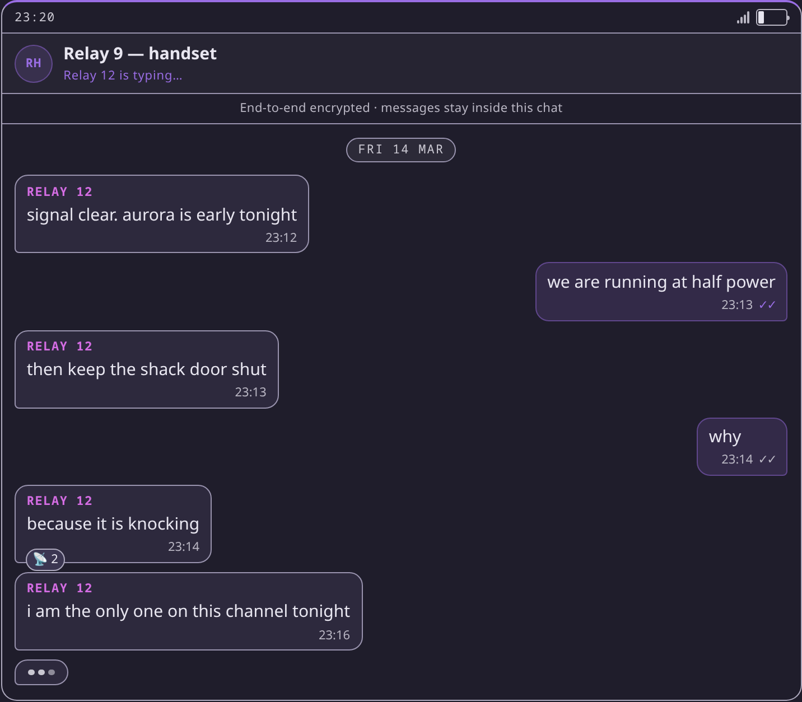
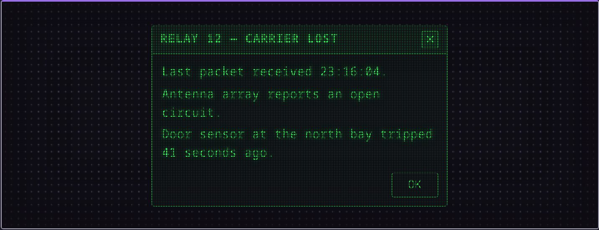
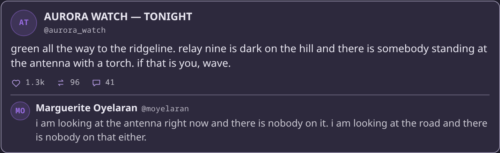

# Fabulist

**SillyTavern, for people who want to edit the outcome instead of the prompt.**

### Wherever you notice something, that's where you can change it.

The narrator does more than write. Mid-scene it can put a working phone, a security
monitor or a social feed into the story as a real panel — and the engine checks every
panel before it renders. A draft that breaks the rules never reaches you: the engine
hands it back, and the narrator repairs its own work.

<p align="center">
  
  
  
</p>

**What it takes to start:** Docker, one OpenAI-compatible endpoint, and about ten
minutes. No model ships in the box — bring a local server or an API key. The optional
memory sidecar is a 2.7 GiB pull.

Bug reports and pull requests are welcome.

---

## The story and the sidebar never disagree

Places, items, relationships and meters are tracked out of the prose and handed back
to the narrator as facts. One local event log owns every turn — the transcript, the
state panel and memory recall are all views of it. Change a value on screen and it
goes through the same validation the agents use. A value you pin is never overwritten
by a render.

<!-- image pending re-shoot -->

## You cannot wreck it

A correction keeps the original and records why. A fork costs nothing — it is a
pointer, not a copy. An edit that would break a later turn is refused, with the
violation named. A failed turn is repaired at the step that failed, not re-run from
scratch.

From here: [What it is](#what-it-is) · [the Studio tour](#the-studio-tour) · [Architecture](#architecture).

---

## Start here

Three steps, about ten minutes. Everything optional is further down.

1. **Two things.** Docker with Compose, and one OpenAI-compatible endpoint: `llama-server`, vLLM,
   LM Studio, Ollama's OpenAI shim, OpenRouter, or any hosted API. Nothing is bundled. A narrator
   wants a large model; extraction and judging are fine on something small.
2. **Boot it.** Take the release's `Dockerfile` and `docker-compose.yml`. The image carries the
   engine and the UI, so the host needs no Node or Python. Make the mount directories as your own
   user first: the image runs as uid 1000, and Docker creates a missing bind mount root-owned, so
   the first boot dies with `sqlite3.OperationalError: unable to open database file`.

   ```sh
   mkdir -p data configs
   docker compose up -d
   ```

3. **Point it at a model.** Open <http://localhost:2727> and add a completion connection in the
   Connections drawer. The sidecar answers embedding, reranking and the yes/no checks; it does not
   write prose. The plain chat needs no persona, card or world, so type a line to take a turn. Then
   open the Studio from the bottom rail and follow the tour.

`./data:/app/data` holds the log, `./configs:/app/configs` your connections. Both are bind mounts:
both must exist first, both survive a rebuild. A `.env` beside the compose file is optional and is
where keys belong.

## The Studio tour

The Studio docks left, right or floats. Its tabs are grouped **Home · Assets · Engine** — the order
a SillyTavern reader ends up caring about.

Two doors come first, not stops. **Connections** points the engine at your endpoint, so the narrator
can be your big local model while the smaller jobs run cheap. **Prompts** is the editor you already
know.

### 1. Flow — Home

One turn is a list of steps, in the order they run, each with what it needs and what it provides.
Hover a step and its prompt opens. Wire an illegal connection and the editor names the violation and
refuses the save. This pane answers "what is this doing while I wait?" — and you may reorder the
answer.

*The turn is a list of steps, and you can reorder it — the editor refuses the change that would have broken your next turn.*

### 2. Proposals — Home

A queue of what your models proposed, waiting for a yes: accept, undo, reject. Below it the
Historian block — its cadence, and **Run historian now**.

*Nothing your models do quietly rewrites your story. It waits here until you say yes, and undo puts back exactly what was there.*

### 3. Worlds — Assets

The world list, with the row meta **N cast · N books**. Open a world for its slots, its image, and
export/import on the header. You own every ingredient; this is the container for them.

*A world is the cast plus the books it reads from — the thing you have been holding together with notes.*

### 4. Books — Assets

A book opens on its entries: comma-separated keys, a **constant** toggle, lore text, an optional
label. Scroll a longer one and it is a real editor, not a viewer.

*Your lorebooks come across as books — same keys, same entries, and now something owns them.*

### 5. Profiles — Assets

An exported profile shows what it will install — Name · World · Cast · Books · Preset — and carries
a toggle for including assistants. This is what you send a friend instead of a zip of folders.

*Your whole setup in one file: the world, the cast, the books, the prompt — the thing a card plus a preset plus a world plus a persona used to be.*

### 6. Queries — Engine

First the anti-slop table: phrase rows, each with a switch. Then a custom question, open: the
instruction, what *yes* and *no* mean, the threshold, the probability. "I keep telling the model not
to do that" becomes something you own.

*Write down the things that ruin a scene. When one turns up, the turn gets sent back to be fixed instead of shipped to you.*

### 7. Templates — Engine

Templates are grouped by class. Open one for its name, what it **implements**, its prompt door and
settings. Every step in Flow is made of one of these.

*A step's behaviour is a template you can copy, rename and re-point — the list in Flow is made of these.*

### 8. NPC lanes — Engine

The switch, the "lanes running at once" width, and **This chat**, reporting what the lanes did last
turn — not what you asked them to.

*Turn the room's other voices on, then look at what they actually did last turn — not what you asked them to.*

**The loop.** Back to Flow: inspect a turn, edit what you noticed, take the next one. Two exits, not
stops: **Connections** (which model does which job) and **Prompts** (still yours).

## What it is

A personal roleplay narrative engine: a MUD with an LLM narrator. SillyTavern-shaped clients fake
agent passes, out-of-band state tracking, generative UI, swipes and branches in prompt space. Here
they get runtimes: an append-only event log, a
[LangGraph](https://langchain-ai.github.io/langgraph/) agent loop, and a component library the
narrator builds panels from. Self-hosted and local-first: your sessions, your log, your keys.

- **One log owns the story.** One SQLite file per session is the truth; transcript, state panel,
  memory index and every agent's context are views of it. A correction is a revision that keeps the
  original and records why. A replay is a swipe. A fork points at the same log instead of copying
  it. Every narrative keeps the config snapshot it was written with.
- **Panels are a checked contract.** The narrator writes prose and statements. Statements come from
  a library generated from the real UI components, and the engine checks each before it renders. One
  that cannot render stays tagged text, never a broken panel. What a panel displays writes back into
  the log through the same checks the agents use.
- **The world keeps its own books.** A tracker agent keeps the registry: places as a tree, items,
  threads, relationships, meters, conditions, money, cast, the player. Each is a typed event, and an
  id is minted once. Presence follows location, so it is deterministic. The narrator receives facts
  and never emits state, so story, sidebar and prompt cannot drift apart.
- **Turns heal themselves, and failures are named.** The engine validates, then repairs at the step
  that found the problem. A clean turn costs one completion; a failed turn is never re-run from
  scratch. A provider failure stops at the step that owns it and names the phase, the status and the
  provider's own words. That covers failures the engine can name: validation, format, provider, gate.
  A turn that is merely unsatisfying is still yours to edit.
- **Cards in, cards out.** Character Card V2 JSON or a PNG `chara` chunk comes in; flat V1 is
  tolerated. One file can seed the persona and the world. Cards export to V2 and PNG with the
  original `data` passed through, so unknown keys survive. Lorebooks import as books. Chat logs do
  not come across.
- **Memory, voice, attachments.** Vector collections per scope (world / actor / chat) over any
  OpenAI-compatible embedding endpoint, with optional reranking and a re-embed job. Local
  speech-to-text. Media attachments normalised with ffmpeg, and a vision-capable narrator sees
  images in the turn.
- **Per-agent connections.** Each agent in a turn — narrator, tracker, critic, embedder, decision —
  can point at its own connection, resolved by type. You supply every endpoint; the context size you
  declare drives warnings, the compaction threshold and prompt headroom.
- **The prompt is no longer the only lever.** Prompt modules, rule switches and the turn order are
  data you edit in the UI, with a compiled preview of what the model will see. Not a deeper prompt
  editor than SillyTavern's Prompt Manager — a second place to reach for.

## 18+ · adult content notice

Fabulist is not a content filter. The output is whatever the models you configure produce. Some
things it ships with can encourage adult / 18+ generation: the NSFW Content directive (off by
default), user presets, imported cards. Using them is your responsibility, and so are the terms of
any provider the engine is pointed at.

## Requirements

- Docker with Compose, and one **OpenAI-compatible endpoint**.
- Python **3.12** with [uv](https://docs.astral.sh/uv/), and Node **>= 22.6** with npm — only to
  build from source or work on the UI.
- **ffmpeg** (+ `ffprobe`) for audio or video attachments.
- Linux, macOS or WSL. The engine needs no GPU; the model server owns that question.

## Install

### Docker

With an empty `./configs` the engine boots and asks you to add a connection in the Connections
drawer. Nothing is needed up front except one completion endpoint: the sidecar serves embedding,
reranking and the decision model, and no prose is written until a narrator is bound.

`.env` beside the compose file becomes container environment; `.env.example` is the commented
template. Compose builds only when the `fabulist:latest` tag is missing, so run
`docker compose build fabulist` if an earlier attempt left an image behind. Voice input is a build
arg, not a default; the compose file shows the line.

### The models sidecar

The default compose file starts **`fabulist-models`** too: one llama.cpp server in Vulkan router
mode. It serves three auxiliary models — `embeddinggemma-2` for memory embeddings, `qwen3-reranker`
for recall reranking, `d1-3b` for the yes/no checks.

Nothing ships in the image. The compose file names each model as a HuggingFace reference, and your
first request downloads it: **~2.7 GiB, once** (2.73 GiB measured). It lands in the named volume
`fabulist-model-cache`, so a rebuild never pays twice. At boot the engine pins the three roles, but
only into empty slots, and never touches the narrator.

Check it with `uv run python scripts/sidecar_smoke.py`. To run the engine without it, use
`docker compose -f docker-compose.app-only.yml up -d`. Exact sizes, the cache, offline weights,
device selection, troubleshooting and the manual pinning:
**[docs/MODELS-SIDECAR.md](docs/MODELS-SIDECAR.md)**.

### From source

```sh
cp configs/connections.example.json configs/connections.json
$EDITOR configs/connections.json          # your endpoints, model ids, and the agents map
uv sync
(cd frontend && npm install && npm run build)
uv run python scripts/serve.py            # engine on :2727, log in data/
```

One origin serves the app and the API, so there is no CORS setup. For UI work,
`cd frontend && npm run dev` and open <http://localhost:5173> — see
[frontend/README.md](frontend/README.md).

### No model at all

```sh
cd frontend && VITE_MOCK=1 npm run dev
```

Every call is answered from an in-memory mock, so the whole UI is explorable with no engine and no
model. A red `MOCK` badge shows while it is active.

## Configuration

`configs/connections.json` is gitignored and yours: endpoints, and which agent uses which endpoint.
Most people never write it by hand. The Connections drawer writes a pasted key into `.env` as one
line (`0600`) and never echoes it back, and the context size you declare there drives the warnings,
the compaction threshold and the prompt headroom.

```json
{
  "connections": {
    "local":  { "base_url": "http://localhost:8080/v1", "model": "your-model-id",
                "sampling": { "temperature": 0.9, "top_p": 0.95, "max_tokens": 2048 }, "timeout": 300 },
    "hosted": { "base_url": "https://openrouter.ai/api/v1", "model": "vendor/model-name",
                "api_key_env": "OPENROUTER_KEY", "timeout": 300 }
  },
  "agents": { "narrator": "hosted", "extractor": "local" }
}
```

`api_key_env` names an environment variable, never the key. Omit it for keyless servers. The
`base_url` rewrite rules, the eleven agent slots and their fallbacks, and known issues #45 / #46:
**[docs/CONFIGURATION.md](docs/CONFIGURATION.md)**.

## API

The API shares the UI's origin. The OpenAPI document is at `/docs`.

### Turns are an SSE stream

`POST /api/sessions/{id}/turns` answers `text/event-stream`. There is no JSON mode and no `Accept`
negotiation, so a plain client gets the stream too. Frames are `id:` / `event:` / `data:` lines;
`: ping` comments keep an idle stream warm. A failure *inside* a turn is not an HTTP status, because
the response is already 200 — it arrives as an `error` event.

**`max_tokens` × thinking models.** A thinking model spends the same budget on reasoning before it
writes anything. A small budget gets eaten by `reasoning_content`, and the stream ends with that
`error` event and no prose. This is the commonest silent-looking failure on a new connection. The
default is `max_tokens: 1024`, so set it explicitly for a thinking narrator (`8192` or more), or
lower the reasoning depth with `reasoning_effort: "low"`.

### Exposure

There is **no authentication** on any route. The image starts the engine with `--host 0.0.0.0`, and
the default compose file publishes `2727:2727`, so the app listens on every host interface
(`docker-compose.host.yml` binds the host's `2727` directly, same result).

On a machine with a public interface, publish loopback only (`"127.0.0.1:2727:2727"`) or put a
reverse proxy with its own authentication in front. `scripts/serve.py` from source defaults to
`127.0.0.1:2727` — the only shipped path that does.

This posture is stated in exactly two places: here and [SECURITY.md](SECURITY.md) (§2, *There is no
authentication — by design*). Change both or neither.

## Architecture

A turn is a compiled graph. Before the narrator runs, steps assemble context — persona and cast,
world definition, recalled memory, plan, runtime notices — and inject state as facts at the end of
the prompt. The **narrator pass emits prose and panels and nothing else**.

At `commit` the turn is kept and you are released. The rest streams its landings into the transcript
behind you: validation and repair, the quality gate and critic, the planner on its cadence, the state
tracker, the environment HUD, attribution.

Everything that lands is an appended event: `user`, `narrative`, `revision`, `state-delta`, `roll`,
`asset`, `summary`, `ooc`, `system`. Only the dispatcher writes. Every read — transcript, state
sidebar, memory index, the next prompt — is a projection over those rows. Derived stores (vector
index, checkpoints) are cache, rebuildable any time; when they disagree with the log, the log wins.
`docs/decisions/README.md` records the rulings that keep that shape honest.

## Docs

- [docs/decisions/README.md](docs/decisions/README.md) — the design rulings
- [docs/MODELS-SIDECAR.md](docs/MODELS-SIDECAR.md) — sidecar models, cache, role pins
- [docs/CONFIGURATION.md](docs/CONFIGURATION.md) — connection rules, agent slots
- [SECURITY.md](SECURITY.md) — threat model, no-auth posture
- [AGENTS.md](AGENTS.md) — repo conventions and verification
- [.env.example](.env.example) — sidecar and key variables
- [docs/PERSONA-SPEC.md](docs/PERSONA-SPEC.md) — persona cards, structured canon
- [docs/PROMPT-SURFACES.md](docs/PROMPT-SURFACES.md) — prompt modules, presets, compiler
- [docs/UI-LANGUAGE.md](docs/UI-LANGUAGE.md) — component flavours
- [docs/UI-COPY.md](docs/UI-COPY.md) — the copy register
- [docs/COMPONENT-PATTERNS.md](docs/COMPONENT-PATTERNS.md) — building a component
- [docs/COMPONENT-SETS.md](docs/COMPONENT-SETS.md) — the frozen `technology` set

## License

Apache-2.0.
